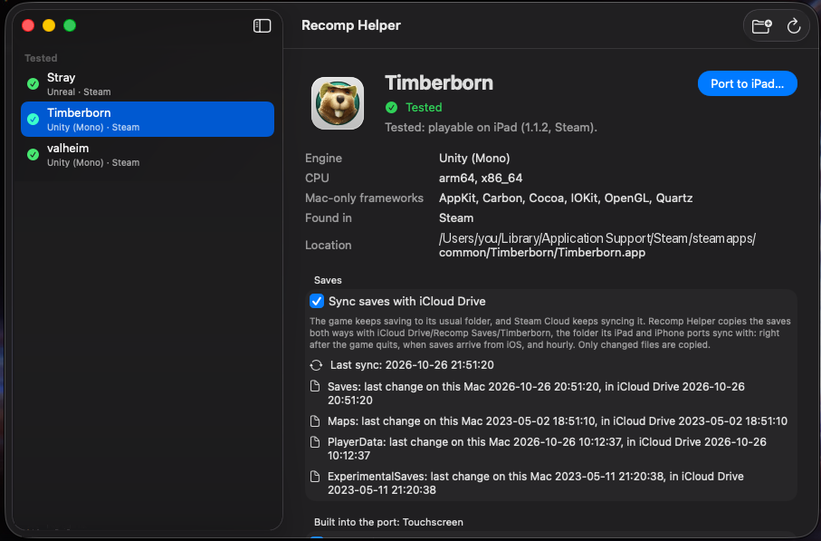

# Mac to iOS / iPadOS Recompilation

Play the Mac games you own on your iPad or iPhone. The tool takes a game installed on your Mac,
recompiles or retargets it for iOS, signs it with your own Apple developer account and installs it
on your device.

> **Your games, your devices.** A port contains the game, so it is for your own devices only: never
> share the app. Ports of Steam games play only after you sign in with a Steam account that owns the
> game.

[Download Recomp Helper](../../releases) · [Getting started](#getting-started) · [Roadmap](#roadmap) · [How it works](docs/TECHNICAL.md)

## Steam in your ports

A port of a Steam game carries its own Steam client, so it is on Steam the way the Mac game is.
You sign in once, with the Steam Mobile app's QR scanner or with your password and Steam Guard, and
that one sign-in covers the following:

- **License:** the game plays for an account that owns it or borrows it through Family Sharing,
  and plays offline for 30 days after the last check.
- **Online status:** your friends see you playing the game, until you leave it.
- **Steam Cloud saves:** the same saves as the game on your Mac or PC. They download when the game
  starts and upload when you leave it, and a prompt lets you choose when two devices changed the
  same save. iCloud Drive sync is for games without Steam.
- **Achievements and stats:** they unlock on your Steam account.
- **DLC:** the port sees the DLC your account owns.
- **Online play** in supported games (Valheim): Steam servers, the server list, crossplay servers
  and join codes, and hosting your own world.

Not there yet: joining a friend's game through Steam's relay, the friends list and invites, the
Steam overlay and the Workshop. Unreal games (Stray) get the license and online status only, for
now. [How it works](docs/TECHNICAL.md#steam-runtime)

## Tested games

Tested on an iPad Pro 11" (M1, iPadOS 26.2) and an iPhone 17 (8 GB).

| Game | Engine | iPad | iPhone |
|---|---|---|---|
| [Timberborn](https://store.steampowered.com/app/1062090/Timberborn/) 1.1.2 | Unity 6, Mono | ✅ Playable | ✅ Playable, with a HUD laid out for the phone |
| [Stray](https://store.steampowered.com/app/1332010/Stray/) 1.5 | Unreal Engine 4.27 | ✅ Playable, early testing | ✅ Playable through chapter 4, at 30 frames/s |
| [Valheim](https://store.steampowered.com/app/892970/Valheim/) 1.0.20 | Unity 6, Mono | ✅ Playable, online play | ✅ Playable |

### Timberborn


| | |
|---|---|
| **App size** | 2.3 GB |
| **Screen** | Landscape |
| **Touch** | In a game, touches drive the map directly: tap to click, drag to pan (or to draw paths and areas with a tool), two fingers to pan, pinch to zoom and twist to turn, a two-finger tap to cancel. Taps on the game's panels go straight to them. [Placement mode](docs/TECHNICAL.md#touch-controls-recomptouchmouse) lets you aim a building, then **Place**; **Rows** drags out paths and walls |
| **Mobile UI** | A HUD laid out for touch: a Colony tab and a View tab with drawers, the tools in a column on the left, rotate, flip and Place in a rail on the right. Always on on iPhone; on iPad, **Settings › Interface › Mobile UI**. Turning it on applies at once; turning it off applies from the next save loaded, or at once with **Reload save now** below the toggle, which saves the game and loads it again (new, not yet tried on a device) |
| **Keys** | **Esc** and **Dev** (the game's developer mode): beside the Dynamic Island on iPhone; on iPad above the tool bar, or bottom right with the Mobile UI. With the Mobile UI, developer mode adds a bug key that opens Development controls in a touch-sized window |
| **Controller** | Not used: Timberborn is played with a mouse |
| **Keyboard, trackpad** | ✅ |
| **Saves on iCloud Drive** | ✅ [Shared](docs/TECHNICAL.md#saves-across-devices) with the Mac and your other devices |
| **Mods** | ✅ Data mods any time; [code mods](docs/TECHNICAL.md#mods-unity-ports) compiled in when porting. The port's own mod, TheSTouchscreen, brings the touch input and the Mobile UI; the port turns it back on at every launch, so unticking it in the mod manager cannot leave the touch input off |
| **Sound** | Plays with the iPhone in silent mode, mixed with other apps' audio, not yet confirmed on a device |
| **Steam** | [Sign-in and license check](docs/TECHNICAL.md#steam-runtime). Achievements, online status and Steam Cloud are built into new ports, not yet tested with Timberborn |
| **Frame rate** | Not measured yet |

Known limits: no hover, so no tooltips or highlight under the cursor (the tool bar's tooltips are
removed); with the game's own HUD on iPad some buttons are small for fingers (raise the in-game UI
scale, or turn on the Mobile UI); a mod with code needs a new port; the local HTTP API's web pages
are off, since they compile templates at run time. A mod folder left over from an older port (the
old `Touchscreen` mod) should be deleted in the Files app: the port never deletes anything on a
device.

### Stray


| | |
|---|---|
| **App size** | 8.4 GB |
| **Screen** | Landscape |
| **Touch** | [On-screen gamepad](docs/TECHNICAL.md#on-screen-gamepad), with a D-pad on the left edge |
| **Controller** | ✅ Bluetooth controller tested; the on-screen pad hides when one connects |
| **Keyboard, trackpad** | ✅ |
| **Saves on iCloud Drive** | ✅ |
| **Steam** | Sign-in, license check and online status. No achievements yet: Unreal games need more of Steam's C++ interface |
| **Frame rate** | iPad M1: 40–50 fps, MetalFX upscaling from 75 %. iPhone 17: 30 fps by default, MetalFX from 75 %, no screen-space reflections; at 60 fps the phone overheats within minutes and slows down. The limit can be changed in the game's options |
| **Memory** | iPhone 17: chapter 4 (The Slums) uses about 5 GB of the 6.1 GB iOS allows, since sounds now decode as they play instead of all being unpacked when a level loads |
| **Sound** | Plays with the iPhone in silent mode, mixed with other apps' audio |

Known limits: played up to chapter 4; short freezes the first time a scene appears, while Metal
compiles its shaders (cached afterwards), and other short freezes on the iPhone; the image looks
soft on the iPhone at 50 %; distant textures can load later than on a Mac, since the texture pool is
sized to the device's memory.

### Valheim


| | |
|---|---|
| **App size** | 4.6 GB, and as much free space again to install an update |
| **Screen** | Landscape on iPad. iPhone: landscape, and portrait built but not yet tried on a device. A swipe from a screen edge needs a second swipe, so the iOS gestures do not interrupt play |
| **Touch** | On-screen gamepad in play; touch acts as the mouse in menus; the iOS keyboard opens for names |
| **Controller** | Not tried yet |
| **Keyboard, trackpad** | ✅ |
| **Saves** | ✅ Steam Cloud, shared with the game on your Mac or PC, conflict prompt included |
| **Sound** | Plays with the iPhone in silent mode, mixed with other apps' audio, not yet confirmed on a device |
| **Online** | ✅ Steam servers by IP (with password) and from the server list, crossplay servers by join code, hosting a world with crossplay. Not yet: joining a friend's game through Steam |
| **Steam** | One sign-in for the license, online status, achievements, Steam Cloud and online play |
| **Frame rate** | Not measured yet. iPhone renders at 75 % |

Known limits: the on-screen gamepad covers parts of the HUD (hotbar slot 1, the minimap corner,
food and health); online play and Steam Cloud are tested on the iPad, not yet on the iPhone.

## Recomp Helper, the Mac app

<p align="center"></p>

Recomp Helper finds the games on your Mac, says which ones can be ported and why, and ports them in
one go.

- **Finds your games** in Steam libraries, `/Applications`, GOG, Epic, itch and Heroic, and in
  folders you add. Windows games, CrossOver bottles included, are listed as not supported, with the
  reason.
- **Sorts them** into *Tested*, *May work out of the box*, *Needs work* and *Not supported*, with the
  reason for each game. A tested game shows its iPad and its iPhone status apart.
- **Ports in one go.** Pick the iPad or iPhone, your signing team and where to keep the build. It runs
  every step with progress bars, a live log and plain hints when something needs you (unlock the iPad,
  sign in to Xcode).
- **Installs on another device** after a port, and checks the device has room first.
- **Mods:** tick which of the Mac's mods go into the port.
- **Saves:** Steam games sync with Steam Cloud; other games can sync through iCloud Drive.

Download the notarized DMG from [Releases](../../releases), or build it yourself
([Building the app](docs/TECHNICAL.md#building-the-app)).

## Getting started

**You need:**

- a Mac with Apple silicon or Intel, on macOS 14 or later;
- Xcode with the iOS SDK, signed in to your Apple developer account;
- the .NET SDK (`brew install dotnet`);
- for Unity games, a free Unity Personal license (open Unity Hub once and sign in) and about 40 GB of
  free disk for the build;
- an iPad or iPhone paired with the Mac, unlocked while the app installs.

**With the app:** open Recomp Helper, select a game, press **Port**.

**From the command line:**

```sh
python3 recomp.py scan                          # your games and whether they can be ported
python3 recomp.py inspect /path/to/Game.app     # engine, CPU, route and blockers for one game
python3 recomp.py env                           # Xcode, signing teams, paired devices

# Unity game: fetch its exact Unity version once, then port
python3 recomp.py toolchain /path/to/Game.app
python3 recomp.py unity  /path/to/Game.app --team <TEAMID> --device "<iPad name>"

# Unreal game
python3 recomp.py unreal /path/to/Game.app --team <TEAMID> --device "<iPad name>"

python3 recomp.py mods  /path/to/Game.app           # which mods go into the next port
python3 recomp.py saves /path/to/Game.app --enable  # games without Steam: share saves through iCloud Drive
```

Set `RECOMP_HOME` to keep the large files (Unity editors, builds) on another disk.

| How long it takes | Measured |
|---|---|
| Valheim, first port | about 10 min just to convert 4 GB of asset bundles (13 GB of RAM at peak) |
| Timberborn, port again after changing mods | 15–20 min with Unity's cache warm |
| Stray, install on the iPad | about 4 min: the whole 8 GB app is copied each time |

## Which games can be ported

**May work out of the box.** Recomp Helper's checks found nothing the route is known to trip over:

- Unity 6 games built with Mono (a `Data/Managed` folder of .NET DLLs), on Apple silicon or Intel:
  the code is recompiled, so the Mac build's CPU does not matter;
- Unreal Engine 4 games built for Apple silicon, when every function the game imports exists on iOS
  or in the port's shim.

**Needs work first** (a game profile, a stub or a patch):

- Unity versions older than 6: the IL2CPP patches are written against Unity 6;
- native plug-ins without a stub or an iOS build (Steamworks is the port's own Steam client,
  PlayFab Party is Microsoft's iOS framework, Apple's Mac plug-ins are stubbed);
- libraries that generate code while the game runs (Harmony, MonoMod): iOS forbids it;
- Unity's old input system: taps act as clicks, but pinch and multi-finger gestures need the Input
  System package;
- large games on an iPhone: an 8 GB iPhone gives an app about 6 GB.

**Not supported:**

- Windows games, CrossOver included: x86 code and DirectX shaders;
- Intel-only native games: iOS forbids JIT, so there is no Rosetta-style translation;
- Unity games built with IL2CPP, Unreal Engine 5, Godot, Ren'Py, LÖVE, HTML5 and custom engines: no
  route yet ([Roadmap](#roadmap)).

Passing the checks is a good sign, not a promise: memory, shaders and input only show on the device.
What each check looks at: [Compatibility checks](docs/TECHNICAL.md#compatibility-checks).

## Roadmap

### Engines
- [x] Unity games built with Mono, recompiled to native code with IL2CPP
- [x] Unreal Engine 4 games for Apple silicon, retargeted to iOS
- [ ] Other native Apple silicon games (custom engines): the same retargeting, with shims per engine
- [ ] Godot, Ren'Py, LÖVE and HTML5 games, on each engine's iOS runtime
- [ ] Intel-only games, by static recompilation, one game at a time

### Devices
- [x] iPad
- [x] iPhone, for Unity and Unreal ports
- [x] Portrait play on iPhone, opted into per game (Valheim)
- [ ] Portrait confirmed on a device
- [x] Stray's chapter 4 on iPhone (it ran out of memory there until 0.4.0)
- [ ] Stray played to the end, on iPad and iPhone

### Controls
- [x] Touch as a mouse: tap, drag, pinch to scroll, two-finger right click, Apple Pencil
- [x] On-screen gamepad for action games, hidden when a controller connects
- [x] A D-pad on the on-screen gamepad (Unreal ports: Stray)
- [x] Bluetooth controllers, keyboards and trackpads
- [x] iOS keyboard for the game's text fields
- [x] Placement mode for building games (Timberborn)
- [x] Timberborn: touches drive the map directly (pan, pinch, twist, tap), through its built-in mod
- [x] Timberborn's Mobile UI: the HUD laid out for touch, always on iPhone, a setting on iPad
- [ ] Tooltips and hover highlights in mouse games
- [ ] On-screen gamepad that keeps clear of the game's HUD (Valheim)

### Steam and saves
- [x] One Steam sign-in per port: QR code, or password and Steam Guard
- [x] Steam license check, Family Sharing included, 30 days offline
- [x] Online status: friends see you playing
- [x] Steam Cloud saves, shared with the Mac and PC game (Valheim)
- [x] Steam achievements and stats (Unity games)
- [x] Online play (Valheim): Steam servers, the server list, crossplay, hosting
- [x] Saves shared between Mac, iPad and iPhone through iCloud Drive, for games without Steam
- [ ] Joining a friend's game through Steam's relay (Valheim)
- [ ] Achievements in Unreal games (Stray)
- [ ] Friends list, invites, Steam overlay, Workshop

### Mods
- [x] Data mods, added any time through Files
- [x] Code mods, compiled into the port
- [x] Harmony patches, woven into the game at port time
- [x] The port's built-in mod stays enabled, whatever the mod manager says
- [ ] Harmony transpilers, reverse patches and patches made while the game runs
- [ ] Mods for Unity games other than Timberborn

### Recomp Helper
- [x] Finds games across Steam, GOG, Epic, itch, Heroic and your folders
- [x] Compatibility check with the reason for each game
- [x] One-click port of Unity and Unreal games, to an iPad or an iPhone
- [x] Install on another device, with a free-space check
- [x] Notarized DMG

### Performance
- [x] Texture memory sized from the device's RAM (Unreal)
- [x] Per-game render settings, such as Stray's MetalFX upscaling
- [x] Stray on iPhone: sounds decoded as they play (1.5 GB less memory), 30 fps against overheating
- [x] A log line every 10 s: frame rate, GPU time, CPU per thread, memory left and thermal state
- [ ] Frame rates measured for every tested game
- [ ] Fewer stutters the first time a scene appears, while Metal compiles shaders
- [ ] Stray on iPhone: no short freezes, a sharper image

## More

- **[How it works](docs/TECHNICAL.md):** the Unity and Unreal routes, game profiles, touch controls in
  detail, mods, save sync rules, the Steam runtime, debugging on the device and building the app.
- **Contributing:** this repository is public. Never commit game files or personal details; see
  [Contributing](docs/TECHNICAL.md#contributing) for the commit guard.
- **License:** [PolyForm Noncommercial 1.0.0](LICENSE): free for personal, hobby, research and other
  noncommercial use; selling it or using it in a commercial product is not allowed. It covers this
  tool only, not the games you port. Versions up to v0.3.0 were released under MIT.
