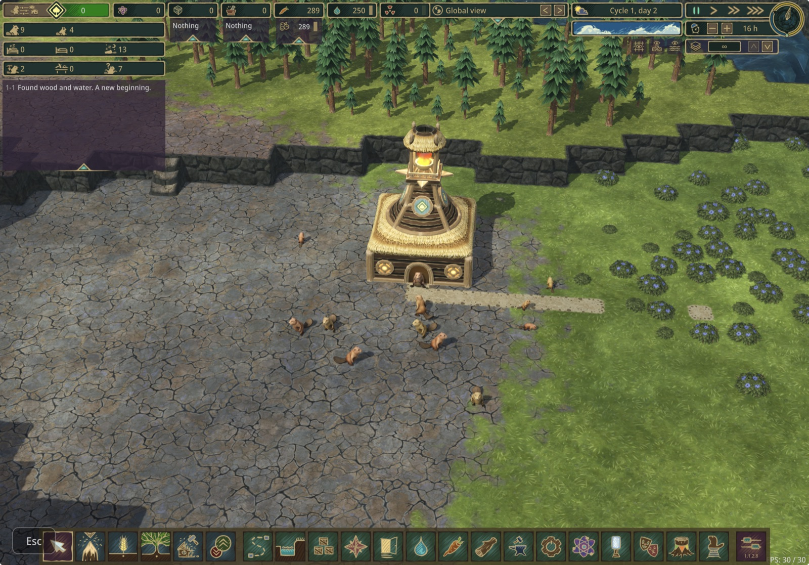
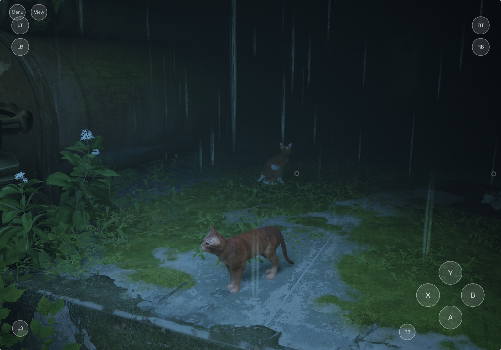
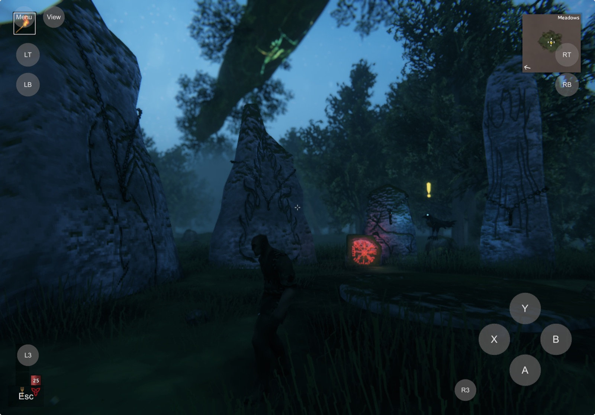

# macToiOSRecomp

Port macOS games you own to your own iPad. Builds are for personal sideloading
with your developer account; never share the resulting app, since it contains the game.

## Tested games

| Game | Version tested | Engine | Route | Status |
|---|---|---|---|---|
| [Timberborn](https://store.steampowered.com/app/1062090/Timberborn/) | 1.1.2 (Steam) | Unity 6000.5.11f1, Mono | Unity / Mono | **Playable** |
| [Stray](https://store.steampowered.com/app/1332010/Stray/) | 1.5 (Steam) | Unreal Engine 4.27, arm64 | Unreal | **Playable** (early testing) |
| [Valheim](https://store.steampowered.com/app/892970/Valheim/) | 1.0.20 (Steam) | Unity 6000.0.75f1, Mono | Unity / Mono | **Playable** (local worlds) |

Tested on an iPad Pro 11" (M1), iPadOS 26.2.

<table>
<tr>
<td width="25%" align="center"><br>Timberborn</td>
<td width="25%" align="center"><br>Stray</td>
<td width="25%" align="center"><br>Valheim</td>
<td width="25%"></td>
</tr>
</table>

### Timberborn

Works: intro video, menus, new games and saves, building, camera pan, zoom and rotation, and
[mods](#mods-unity-ports) (tested: Ladder, code and data). A **Dev** key above Esc toggles the
game's developer mode (Alt+Shift+Z), whose panel can unlock buildings for testing.
The port carries its own mod, **Touchscreen** (on by default in the game's mod list): placing a
building works as with a mouse, see [placement mode](#touch-controls-recomptouchmouse).

Known limits:

- the game is designed for a mouse: there is no hover (tooltips, highlight under the cursor),
  and some buttons are small for fingers (raising the in-game UI scale helps);
- the local HTTP API's web pages are disabled ([profile](recomp/profiles/timberborn.json)):
  they compile templates at runtime, which IL2CPP cannot do;
- a mod with code runs only if it was installed on the Mac when the game was ported
  ([Mods](#mods-unity-ports)); data-only mods can also be added on the iPad through Files.

### Stray

Works: intro, brightness setup, cutscene videos, sound, gameplay with the on-screen gamepad or a
Bluetooth controller; about 40-50 fps at the iPad's point resolution.

Known limits:

- early testing: only the opening area has been played;
- short freezes the first time a scene appears, while Metal compiles its shaders (they are cached for
  later runs);
- the texture streaming pool is capped to the iPad's memory ([profile](recomp/profiles/stray.json)),
  so distant textures can load later than on a Mac;
- no Steam: achievements and cloud saves are off, saves stay on the iPad.

### Valheim

Works: menus, character creation (the iOS keyboard opens for the name), new and existing local
worlds, gameplay with the on-screen gamepad, saving through Logout and loading again.

Known limits:

- local worlds only: online play, crossplay and Steam Cloud are off. Valheim refuses to run without
  Steam, so the port's Steam stub signs in as an offline user ([profile](recomp/profiles/valheim.json));
- a Bluetooth controller has not been tried yet;
- the on-screen gamepad covers parts of the HUD (Menu over hotbar slot 1, RT over the minimap
  corner, the Esc button over the food and health bars);
- frame rate not measured yet; the game renders at the iPad's point resolution;
- the first build converts about 4 GB of asset bundles for iOS (~10 minutes, ~13 GB of RAM at
  peak); later builds reuse the result. The app is about 4.6 GB, and installing an update needs
  as much free space again on the iPad;
- characters and worlds kept in Steam Cloud on the Mac are not in the local save folders: move them
  to local storage in Valheim's menus to carry them over ([Saves across devices](#saves-across-devices)).

## Recomp Helper (Mac app)

Download the notarized DMG from [Releases](../../releases), or build it yourself (below).
The app:

1. scans Steam libraries, `/Applications`, `~/Applications`, GOG, Epic, itch and Heroic folders,
   plus any folders you add; Windows installs (Steam libraries in CrossOver bottles, found on
   their own, and Windows game folders in the folders you add) are listed too, as *Not supported*
   with the reason: the routes start from a Mac build, and a Windows build has x86 code and
   DirectX shaders;
2. sorts what it finds, with the reason for each game, into:
   - *Tested*: a game profile records it as played on an iPad;
   - *Untested: may work out of the box*: a route handles it and none of the checks below found
     anything that route is known to trip over;
   - *Needs work*: a route handles it, but a check found something that stops the port or needs a
     profile first (listed under Compatibility);
   - *Not yet supported*, *Not supported* and *Not installed*;
3. for a game whose profile knows its mods (Timberborn), lists the mods installed on the Mac in a
   Mods box with a checkbox each, and what the port can do with them ([Mods](#mods-unity-ports));
4. for a game a route handles (Unity or Unreal), asks up front for everything it needs (iPad,
   signing team, bundle ID, where to keep the workspace: ~40 GB for Unity, a few GB for Unreal
   when it is on the game's disk; for Unity, permission to download the matching editor), then
   runs the whole port with progress bars, a live log and plain-language hints when something
   needs your attention (unlock the iPad, sign in to Xcode, …).

The checks (`recomp/compat.py`), which run on every scan:

- **Unity (Mono)**: Unity 6 (the line the libil2cpp patches were written against); no native plugin
  that game code calls without a stub (`stubs/`); no library that generates code at run time
  (Harmony, MonoMod, Handlebars.Net). The Mac build's CPU does not matter: the .NET code is
  recompiled. A game on Unity's legacy input still counts, with a note: taps act as left clicks,
  but the other touch gestures need the Input System package.
- **Unreal (arm64)**: Unreal Engine 4's bundle layout; every Mach-O thin arm64; and a dry run of
  the `prepare` stage's import binding: every import of the game's binaries must bind to iOS or to
  `RecompAppKit.dylib`. That needs Xcode; the result is cached until the game or the shim changes.

Passing the checks is a good sign, not a promise: what a game does at run time (memory, shaders,
input, code paths the checks cannot see) only shows on the iPad.

Requirements: an Apple Silicon or Intel Mac on macOS 14+, Xcode with the iOS SDK, the
.NET SDK (`brew install dotnet`), an Apple Developer account signed in to Xcode, a free
Unity Personal license (open Unity Hub once and sign in), and an iPad paired with the Mac.

## Command line

```
python3 recomp.py scan                       # installed games and their support status
python3 recomp.py inspect /path/to/Game.app  # detailed triage of one bundle
python3 recomp.py env                        # build tools, signing teams, paired devices
python3 recomp.py saves /path/to/Game.app --enable   # share its saves with the iOS ports (see below)
python3 recomp.py mods /path/to/Game.app     # its mods on this Mac and what the next port does with them
```

Set `RECOMP_HOME` to put the large files (Unity editors, build output) on another disk.

`inspect` reports the engine, CPU architectures, Mac-only frameworks and which route applies:

| Route | Games | How |
|---|---|---|
| **Unity / Mono** (implemented) | Unity games whose `Data/Managed` holds .NET assemblies | Recompile the game's assemblies to native ARM64 code with the matching Unity version's IL2CPP, then run the game's own data on Unity's iOS player |
| **Unreal** (implemented) | Unreal Engine 4 games built for Apple Silicon | Re-mark the game's own arm64 binaries as iOS and bind what iOS lacks (AppKit, Mac display and audio APIs) to a shim library |
| Mach-O retarget (planned) | Other native arm64 games (custom engines) | Same retargeting, with shims for what each engine uses |
| Engine runtime swap (planned) | Godot, Ren'Py, LÖVE, HTML5 | Run the game's data on the engine's iOS runtime |
| Static recompilation | Intel-only games | Per-game project; iPadOS forbids JIT, so no Rosetta-style translation |

## Unity route

```
python3 recomp.py toolchain <Game.app>        # fetch that exact Unity version + iOS support into toolchain/
python3 recomp.py unity <Game.app> --team <TEAMID> --bundle-id <id> --device <iPad name or UDID>
```

Stages (run all, or name some): `prepare player inject xcode install`.

1. **prepare**: a shell Unity project in `build/<Game>/shell` gets every game-owned
   assembly as an iOS-only plugin (engine and class-library assemblies come from Unity's
   iOS player instead). P/Invokes into libraries iOS lacks (Steamworks, PlayFab Party, Apple's
   Mac plug-ins, a game's own Mac helpers: `STUB_PROFILES` in `recomp/unity_ios.py`) are
   redirected to `__Internal` and a generated C stub (`stubs/*.overrides.c` for functions where 0
   is the wrong answer). Managed shims from `recomp/shims` are added (touch controls), and the
   selected mods' DLLs, with their Harmony patches woven in ([Mods](#mods-unity-ports)).
2. **player**: the matching editor builds the shell for iOS in batchmode, which runs IL2CPP
   over all of it and writes an Xcode project.
3. **inject**: the shell's data is replaced with the game's (`StreamingAssets` → `Data/Raw`);
   IL2CPP metadata and the iOS default resources stay; serialized files are retargeted to iOS;
   BC textures become ASTC (iOS cannot sample BC); asset bundles get both, repacked, and are
   cached in `cache/bundles/<Game>`; shims are registered in `RuntimeInitializeOnLoads.json`.
4. **xcode** / **install**: sign with automatic provisioning and install through `devicectl`;
   install then copies the ported mods to the iPad's mod folder.

The game must be built with exactly the Unity version it shipped with; `toolchain` reads it from
the game's `Info.plist`. When a game updates its Unity version, delete `build/<Game>` (its shell
project and Xcode output belong to the old editor) and run every stage again.

Two kinds of fixes apply on top of the generic pipeline:

- **libil2cpp patches** (`recomp/il2cpp_patches.py`) fill reflection calls that IL2CPP leaves
  unimplemented and restore Mono's assembly order. Each checks the exact original source text
  and stops the build when a Unity version differs, rather than patching blindly.
- **Game profiles** (`recomp/profiles/<game>.json`) hold game-specific rules:

  ```json
  {
    "name": "Timberborn",
    "tested": "playable on iPad (1.1.2, Steam).",
    "when_assembly": "Timberborn.HttpApiSystem.dll",
    "guard": {"<Assembly>.dll": ["Namespace.Type::Method"]},
    "why": "shown in the build log"
  }
  ```

  A profile applies when the game ships `when_assembly`. `tested`, when present, says the game
  has been played on an iPad (the scan lists it as *Tested*). Each `guard` method (which must return
  `void`) is rewritten so an exception it throws is logged and swallowed: for optional systems
  that cannot work on iOS and would otherwise abort start-up. A guard that no longer matches
  a method fails the build. Other keys:

  | Key | Effect |
  |---|---|
  | `returns` | `{"<Assembly>.dll": {"Type::Method": value}}`: the method only returns that string, bool or int (e.g. a platform check with no iOS answer) |
  | `stub_overrides` | swaps a stub profile's override files, e.g. Steamworks that signs in offline instead of reporting "no Steam" |
  | `touch_gamepad` | `true` for action games: on-screen gamepad in play (see below) |
  | `saves` | where the game keeps its saves on the Mac and on iOS, for syncing them between devices |
  | `mods` | where the game keeps its mods on the Mac and on iOS, for compiling them in ([Mods](#mods-unity-ports)) |
  | `touch_keys` | extra on-screen keys above Esc: `[{"label": "Dev", "keys": ["leftAlt", "leftShift", "z"]}]` (Input System key names, held together) |

Debugging on the device: launch with
`xcrun devicectl device process launch --console --terminate-existing --device <UDID> <bundle id>`
(iPad unlocked). The shims log lines starting with `[recomp]`. Games that write their own logs or
error reports put them under the app's `Documents`, visible in the Files app.

## Unreal route

```
python3 recomp.py unreal <Game.app> --team <TEAMID> --bundle-id <id> --device <iPad name or UDID>
```

Stages (run all, or name some): `prepare xcode install`. Recomp Helper runs the same stages.

1. **prepare**: every Mach-O in the bundle is rewritten for iOS (`recomp/macho.py`): the platform
   becomes iOS, framework paths take their iOS form, and the main executable's imports are rebound
   library by library. Symbols iOS does not export (or that the route intercepts, listed in
   `INTERCEPT` in `recomp/unreal_ios.py`) bind to `RecompAppKit.dylib`, built from
   `recomp/native/appkit`; `libsteam_api.dylib` is replaced by a stub that reports Steam as not running.
   The engine's two `Contents/UE4/` path strings are patched to the bundle's `MacFiles/` folder.
2. **xcode**: a small generated Xcode project builds a placeholder app; its script phase puts the
   game's executable, the shim and APFS clones of the game data (instant on the same disk) into the
   bundle before Xcode signs it with automatic provisioning.
3. **install**: through `devicectl`. The whole app (about 8 GB for Stray) is copied each time.

What the shim provides:

- **AppKit on UIKit**: application lifecycle, windows (shown full screen, scaled to fit), views
  hosting the game's `CAMetalLayer`, events from the keyboard, trackpad and mouse, screens, cursors,
  menus, pasteboard, alerts;
- **Mac system APIs**: Quartz display modes and CVDisplayLink, keyboard layouts, the IOKit GPU entries
  Unreal looks for (answered with the real Metal device), CoreAudio's device queries (one output at the
  session's sample rate) and macOS audio units mapped to their iOS counterparts;
- **Metal differences**: managed storage becomes shared, Mac GPU families are reported, and
  metallibs from older tools load once their macOS flag is cleared;
- **case-insensitive file lookups**, as on a Mac's default volume (games ask for
  `libAPEXFramework.dylib` and ship `libApexFramework.dylib`);
- an **on-screen gamepad** (below), and per-game engine settings from the profile.

Game profiles for this route match on the Unreal project folder:

```json
{
  "name": "Stray",
  "tested": "playable on iPad, early testing (1.5, Steam).",
  "unreal_project": "Hk_project",
  "engine_ini": {"SystemSettings": {"r.Streaming.PoolSize": "auto"}},
  "why": "shown in the build log"
}
```

`engine_ini` keys are written into the game's user config (`Engine.ini`) at each launch, and
`game_user_settings_ini` keys into `GameUserSettings.ini` (the game's own options, such as its
upscaler and screen percentage); `auto` for `r.Streaming.PoolSize` sizes the texture pool from the
device's RAM. `intercept` lists extra imports
to bind to the shim, and `patches` replaces byte strings in the executable (hex, same length).

Debugging: shipping builds log almost nothing, but Mac game binaries usually keep their symbol table.

- the shim logs lines starting with `[recomp]`: unimplemented AppKit methods (they return zero instead
  of crashing), a backtrace when the game calls `exit`/`abort` with an error, and every 10 s the frame
  rate and the memory left;
- copy an empty file named `recomp-screenshot` into the app's `Documents` (`devicectl device copy to
  --domain-type appDataContainer`) to get `recomp-screen.png` back from the same folder;
- `xcrun lldb` can attach to the game on the device (`device select <UDID>`, `device process attach
  -p <pid>` after a `devicectl ... launch --start-stopped`); give it ~20 s to load symbols;
- `tools/xref.py` finds the code that uses a string or address.

## On-screen gamepad

Action games get an on-screen gamepad: every Unreal port, and Unity ports whose profile sets
`touch_gamepad` (Valheim; not Timberborn, which is played with the mouse). Touches drive a game
controller that the game reads like a real one, so its prompts show gamepad buttons. It hides while
a physical controller is connected. In Unity ports it shows only while the game has locked the
cursor (in play); in menus touches act as the mouse, and a quick tap off the pad's buttons is a click.

| Where | Control |
|---|---|
| left half of the screen | move stick (appears where the finger lands) |
| right half of the screen | camera stick |
| bottom right | A, B, X, Y |
| top corners | LB, LT (left), RB, RT (right) |
| top left | Menu, View |
| bottom left / near the face buttons | L3 / R3 |

The key buttons (Unity ports) stay on screen with or without a controller.

## Touch controls (Recomp.TouchMouse)

| Gesture | Mouse |
|---|---|
| 1 finger tap / drag | left click / drag |
| 2 finger drag | middle drag |
| pinch | scroll wheel |
| 3 finger drag | right drag |
| 2 finger tap | right click |
| Apple Pencil | like one finger (iOS reports it as a pen, which games that read the mouse ignore) |
| key buttons (bottom left) | Esc, and above it the profile's `touch_keys` (Timberborn: Dev) |
| tap a text field | the iOS keyboard opens (TextMeshPro fields) |

**Placement mode** (Timberborn, through its built-in Touchscreen mod). Desktop building games show
a ghost of the building under the mouse, let you rotate it, and place it on the click; a tap is a
click the moment it lifts, so there would be no time to rotate. While a building, path or platform
tool is active:

| Touch | Effect |
|---|---|
| 1 finger or the pencil on the map | moves the mouse without clicking: the ghost follows and stays where you lift |
| tap the game's UI (rotate, flip, menus, another building) | clicks at once; the mouse then goes back to where you aimed, so the ghost reappears there |
| **Place** (in the game's placement panel) | clicks where you aimed |
| **Rows** (in the game's placement panel) | lit: touches act directly again, so a drag draws a row (paths, walls) and places it on lift |
| 2 and 3 finger gestures | the camera, as usual |

Whether a touch is on the UI is asked of the game's EventSystem two frames after the mouse moved
onto the finger, the same test the game makes before it places. The shim side is
`Recomp.Placement` (a game mod sets `Placement.Active`); turning the mod off in the game's mod
list brings back placing on touch.

The virtual devices are named `Mouse` and `Keyboard`, like desktop ones: games store their
bindings as control paths such as `/Mouse/leftButton`, which match a device by name. The key
buttons press their keys on whichever keyboard those bindings resolve to. They are drawn with UI
Toolkit when the game uses it, otherwise as a uGUI overlay.
A real keyboard or trackpad, when connected, works alongside.

## Mods (Unity ports)

iOS does not let an app turn new code into machine code while it runs (no JIT). So a mod's code
can only run on the iPad if it was compiled into the app when the game was ported. Its data files
(blueprints, models, textures, translations) are read by the game as usual.

| Kind of mod | How it gets onto the iPad |
|---|---|
| **Data only** (no `.dll`) | Any time: drop its folder into Files > On My iPad > Timberborn > Mods. |
| **With code** (`.dll`) | Install it on the Mac, then port the game. Adding, updating or removing one means porting again. |
| **With Harmony patches** | The same. Its patches are woven into the game when it is ported (below). |

To add mods with code:

1. Install the mods for the Mac game as usual: subscribe in the Steam Workshop, or put the mod's
   folder in `~/Documents/Timberborn/Mods`. Start the game on the Mac once to check they work
   there; mods made for an older game version usually fail on both.
2. Choose which go into the port: the Mods box in Recomp Helper (one checkbox per mod), or
   `python3 recomp.py mods <Game.app>` to list them and `--exclude <id>` / `--include <id>` to change
   the choice. New mods are included unless you exclude them. Each mod shows what the port will do
   with it: its code is compiled in, it is data only, or it cannot run on iOS and why.
3. Port the game (Recomp Helper, or `recomp.py unity …`). The install stage also copies the
   ported mods to the iPad's mod folder (`recomp.py mods <Game.app> --device … --bundle-id …` does
   that alone). It adds and overwrites files, and leaves other mods in the iPad's folder alone; if
   an update deleted files from a mod, delete that mod's folder in Files first. Re-porting after
   a mod change takes ~15-20 minutes once Unity's cache is warm.
4. On the iPad, the game shows its mod manager at start; tap Start. Mods can be turned off there
   like on the Mac.

Every Timberborn port also carries **Touchscreen**, a mod of the port itself
(`recomp/builtin_mods/timberborn/Touchscreen`, listed by the profile's `mods.builtin`): it is built
against the game and the port's shims when the game is ported, and goes through the same checks
and install as the Mac's mods (source *Built in*). It is the place for touch tweaks of the game's
own UI. Recomp Helper shows it in its own box (*Built into the port: Touchscreen*) rather than with the Mac's
mods, on by default; turning it off there leaves it out of the next port (`recomp.py mods
--exclude Recomp.Touchscreen`). On the iPad it can also be turned off in the game's mod list,
without porting again. Other built-in mods (say, a small-screen UI for iPhone) would sit next to
it in `mods.builtin`, each with its own box.

What happens during the port (`recomp/mods.py`):

- the mod folders the game's profile names (`mods.mac`: Timberborn's Mods folder and its Steam
  Workshop folder) are scanned, and for each mod the version folder the game itself would load
  (`version-1.1/`, …);
- each DLL is checked against the iOS class library and this game version (`asmtool check`). A mod
  that uses something missing (an outdated mod, or an API that needs code generated at run time)
  is skipped with the reason, rather than stopping the build;
- the DLLs that pass are compiled with the game. On the iPad, when the game loads a mod DLL, the
  [libil2cpp patch](recomp/il2cpp_patches.py) recognises it by its SHA-256 and returns the
  compiled assembly. Until then the mod's code is hidden from the game, so a disabled mod stays
  off. A DLL that was not compiled in is skipped with one log line;
- Harmony mods: `0Harmony.dll` is replaced by a stand-in with Harmony's API
  ([recomp/shims/RecompHarmony](recomp/shims/RecompHarmony)), whose `PatchAll` does nothing, and
  each mod's `[HarmonyPatch]` classes are woven into the game's assemblies (`asmtool harmony`).
  The woven patches only act once the game has loaded that mod. Supported: targets given in
  `[HarmonyPatch]` (method, getter, setter, constructor, with argument types) or by a
  `TargetMethod()` built from `AccessTools` lookups; prefixes (including ones that skip the
  original), postfixes, finalizers; `__instance`, `__result`, `__state`, `__runOriginal`,
  `__originalMethod`, `__exception`, `__0`…, `___field` and arguments by name; `Prepare()` and
  priorities. Not supported, reported per patch: transpilers, reverse patches, `TargetMethods()`,
  `__args`, patches made at run time with `harmony.Patch(...)`, and `AccessTools.FieldRefAccess`.

Mods for other Unity games need a `mods` block in the game's profile, and that game's mod loader
has to load DLLs with `Assembly.Load(bytes)` or `Assembly.LoadFrom(path)`.

## Saves across devices

Games whose profile has a `saves` block (Timberborn, Stray, Valheim) share their saves through
iCloud Drive, in `iCloud Drive/Recomp Saves/<Game>/`, which Files and Finder both show. No Apple ID
setup or iCloud entitlement is needed; it works with any developer account.

- **iPad / iPhone**: at the first launch the port asks "Sync saves with your other devices through
  iCloud Drive?". Choose folder, then pick iCloud Drive > Recomp Saves (or its `<Game>` folder;
  create it if it does not exist). The port then syncs at launch (before the game reads its saves,
  at most 15 s), when it goes to the background, when it quits, and every 5 minutes.
  "Not now" writes `Recomp Saves.txt` in the app's folder (Files > On My iPad > `<Game>`); delete it
  to be asked again. With sync on, that file shows the folder, the last sync and any errors; rename
  it to `Recomp Saves off.txt` to stop syncing.
- **Mac**: in Recomp Helper, select the game and turn on *Sync saves with iCloud Drive* (or
  `python3 recomp.py saves <Game.app> --enable`). The Mac game keeps saving to its usual folder and
  Steam Cloud keeps working; Recomp Helper copies the saves both ways right after the game quits,
  when saves arrive from iOS, and hourly. macOS asks once to let Recomp Helper read Documents and
  iCloud Drive, and lists it under Login Items > Allow in the Background (leave it on). The first
  `--enable` backs the saves up to `~/Library/Application Support/Recomp Helper/save-backups/`.
  `recomp.py saves <Game.app> --status|--sync|--disable` does the rest.

Rules:

- per file, the newest version wins;
- when a file changed on two devices since they last synced, the other version is kept next to it as
  `<name>.conflict-<device>-<yyyyMMdd-HHmm><ext>`. If both devices were offline at the same time,
  iCloud Drive may keep the second one as `<name> 2<ext>` instead. Nothing is lost either way;
- deleting a save never deletes it on other devices: delete it everywhere;
- a device's first sync compares dates only, so a fresh install's default file can win over older
  progress (the older one is kept as a conflict copy). Turn sync on before playing on a new device.

Limits:

- saves only move while the game is not running on the Mac, and while the port runs or is in the
  background on iOS;
- saves kept only through Steam Cloud's API are not covered, since Steam is stubbed on iOS.
  Valheim's Steam Cloud worlds and characters are an example: move them to local storage in
  Valheim's menus on the Mac first;
- saves that need mods load only when the port has the same mods ([Mods](#mods-unity-ports));
- local (ad-hoc signed) builds of Recomp Helper are a new app to macOS each time, so it asks for
  folder access again after each rebuild. A Developer ID build does not.

## Building the app

```
scripts/build-app.sh                                     # local, ad-hoc signed, in dist/
SIGN_ID="Developer ID Application: <name> (<TEAMID>)" NOTARY_PROFILE=<profile> scripts/build-app.sh
```

The second form signs with the hardened runtime, builds a DMG, notarizes and staples it.
Create the notary profile once with
`xcrun notarytool store-credentials <profile> --apple-id <apple-id> --team-id <TEAMID>`.
The app bundles the engine from `git archive HEAD`, so only committed files ship.
`swift scripts/make-icon.swift` regenerates the icon.

## Contributing

This repository is public. Never commit game files or personal details: enable the guard
once per clone with `git config core.hooksPath .githooks`, and list your own private
strings (name, email, team ID, device names) as regexes in `.git/private-patterns`, which
stays on your machine.

## Layout

- `recomp.py`: CLI
- `app/`: Recomp Helper, the SwiftUI front end (talks to `recomp.py` through `RECOMP_EVENTS=1` progress lines)
- `scripts/`: app build, signing, notarization and icon
- `recomp/discover.py`: game scanning and environment checks; `recomp/windows_games.py`: Windows installs; `recomp/compat.py`: tested / untested / needs-work checks; `recomp/events.py`: progress events and failure hints
- `recomp/unity_ios.py`, `recomp/toolchain.py`, `recomp/unity_editor/`: Unity route
- `recomp/unreal_ios.py`: Unreal route; `recomp/macho.py`: Mach-O retargeting; `recomp/iossdk.py`: what
  the iOS SDK exports; `recomp/xcodeproj.py`: minimal Xcode project
- `recomp/native/appkit/`: the shim for retargeted Mac binaries; `recomp/native/steam_api_stub.c`
- `recomp/il2cpp_patches.py`: libil2cpp patches; `recomp/profiles/`: per-game rules (both routes)
- `recomp/textures.py`: BCn → ASTC texture conversion and asset bundle retargeting; `recomp/native/`:
  native start-up fixes and `RecompSaves.m`, the iOS side of the save sync
- `recomp/saves.py`: the Mac side of the save sync (`recomp.py saves`)
- `recomp/mods.py`: mods compiled into Unity ports (`recomp.py mods`)
- `recomp/shims/`: managed shims injected into games; `recomp/shims/RecompHarmony`: the Harmony stand-in
- `docs/images/`: screenshots for this README (the gallery holds four per row; add a `<td>` per game)
- `stubs/`: hand-written native stub overrides
- `tools/inspect_app.py`: triage; `tools/xref.py`: find code using a string; `tools/asmtool`: assembly scan/rewrite and Harmony weaving (Mono.Cecil); `tools/ilspy.sh`: decompiler
- `toolchain/`, `build/`: downloaded editors and per-game work (not in git)
